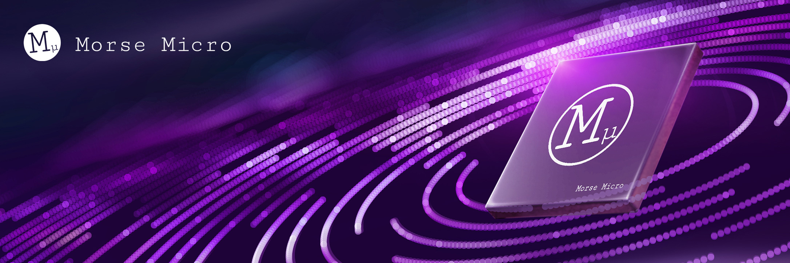

# Morse Micro Labs

This labs space is for early stage [Morse Micro](https://github.com/MorseMicro) projects. Tools, proofs of concept, and experimental projects, which don't yet belong in our main organisation, are shared here.

> [!IMPORTANT]
> Repositories here are provided as-is. They are not tested, not maintained, and not officially supported. Use them at your own risk. Do not rely on them for production systems.

## What you'll find here

- Experimental projects and demos;
- Work-in-progress ideas;
- Archived explorations that might still be useful to someone;

## Official software

For production-ready, supported Wi-Fi HaLow software, visit the main [Morse Micro GitHub organisation](https://github.com/MorseMicro).

## Support

There is no support for projects in this organisation. For help with official Morse Micro software, use the [community forum](https://community.morsemicro.com/).
